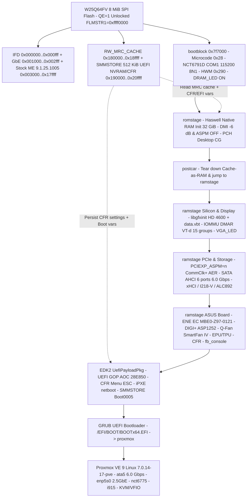
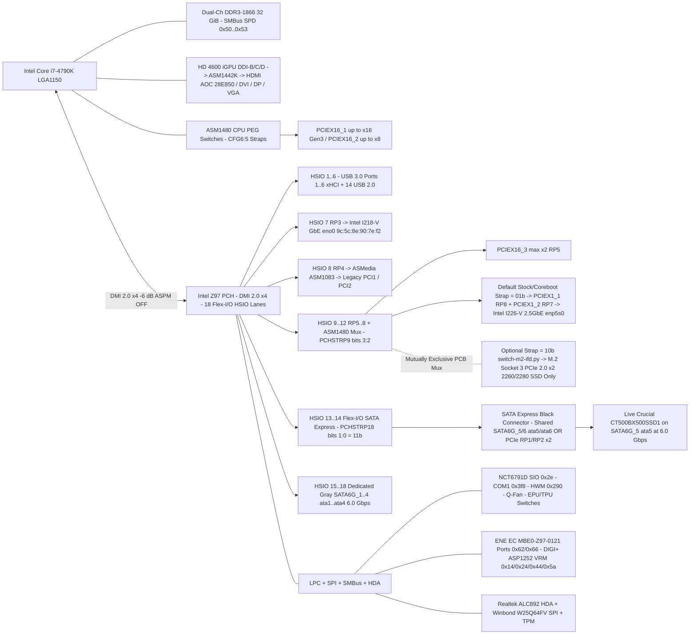
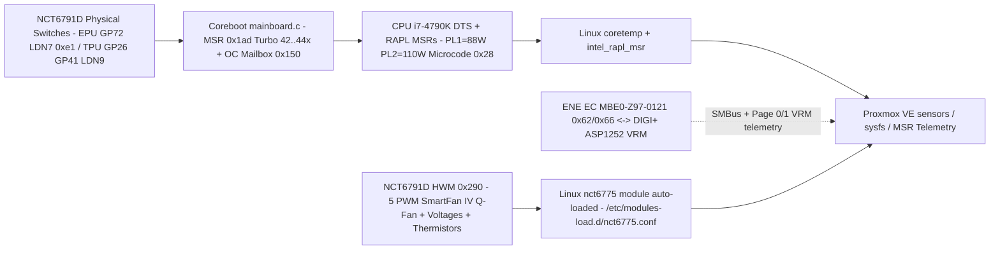

# ASUS Z97-A (`Rev 1.03B`) Coreboot `v0.15` Hardware & Software Flow

**Target System:** ASUSTeK `Z97-A` `Rev 1.03B` | `i7-4790K` (`CPUID 0x306c3`) | `32 GiB` DDR3-1866 | `CT500BX500SSD1` (`SATA6G_5` / `ata5` @ `6.0 Gbps`) | `I218-V` + `I226-V` 2.5GbE | `AOC 28E850` (`1920x1080` HDMI)
**Finalized Firmware:** `coreboot -z97a-v0.15` + `EDK2 UefiPayloadPkg` + `iPXE` | **OS:** Proxmox VE 9 (`Linux 7.0.14-17-pve`)

> **Boardview `.FZ` Encryption Note:** `datasheets/ASUS Z97-A REV 1.03B - Boardview (.FZ).FZ` (not redistributed in Git) uses OpenBoardView's encrypted RC6 key (`FZKey`, 44 32-bit words). Every electrical mux, strap, and lane assignment below is proven directly from the Intel 9-Series PCH Datasheet (`Table 2-1`, `PCIEPCS`), ASUS Z97-A User Guide (`p. 6, 7, 13, 37, 41, 95-97`), `ASM1480` Datasheet, Stock ROM `IFD` (`PCHSTRP9`/`PCHSTRP18`), Stock `PcieLaneDXE` disassembly, and live hardware telemetry on `192.168.1.150`.

---

## 1. Coreboot `v0.15` Software Boot Flow

---

## 2. Z97-A Hardware & Intel Flex-I/O Interconnect (`2x PCIe x1`, `M.2`, `SATA 1..4`, `SATA Express 5/6`)

---

## 3. OS Sensors, Telemetry, EPU/TPU & Power/Thermal Control Flow

---

## 4. Stock ROM Configuration vs. Coreboot `v0.15` Live Verification (`192.168.1.150`)

### A. Stock ROM `IFD` Straps & `PcieLaneDXE` Rules (`z97-a-original-chip.bin`)

| Interface / Pool | PCH Flex-I/O / Chipset Lanes | Stock `IFD` Strap / `Setup` NVAR (`0x1a0077`) | Default Mode & Exclusivity |
| :--- | :--- | :--- | :--- |
| **`PCIEX1_1` + `PCIEX1_2` vs `M.2 Socket 3`** | `HSIO 9..12` (`RP5..RP8`) + `ASM1480` mux | `PCHSTRP9 (0x124) = 0xf0544a85` (`[3:2]=01b`, `[14]=1`), `Setup[0x852]=0x00`, `Setup[0x7ee]=0x01` | **`PCIEX1_1 (RP8)` + `PCIEX1_2 (RP7, I226-V)` active at x1**; `M.2` disabled. Setting `Setup[0x852]=0x01` or `switch-m2-ifd.py m2-x2` switches `[3:2]=10b` (`M.2` PCIe 2.0 `x2`, disables `PCIEX1_1`/`_2`). `M.2` supports **PCIe SSDs only** (no SATA M.2). |
| **`SATA Express` (`SATA6G_5/6`)** | `HSIO 13..14` (`SATA_TX/RX 4..5` / `PER/PET 1..2`) | `PCHSTRP18 (0x148) = 0x00000003` (`[1:0]=11b`), `Setup[0x2d0]=0x01` | Black mid-board `SATA Express` connector accepts **2x SATA 6.0 Gbps (`ata5`/`ata6`) OR PCIe `x2` (`RP1/RP2`)** via Flex-I/O pin ownership (`00:1c.0 + 0x410 = 0x600`). Live Crucial BX500 runs on `SATA6G_5` (`ata5`) at **`6.0 Gbps`**. |
| **`SATA6G_1..4`** | `HSIO 15..18` (`SATA_TX/RX 0..3`) | `sata_port_map = 0x3f` (AHCI) | 4 dedicated gray SATA `6.0 Gbps` ports (`ata1..ata4`). |
| **Onboard `I218-V` / `ASM1083`** | `HSIO 7` (`RP3`) & `HSIO 8` (`RP4`) | `PCHSTRP9[1:0]=01b`, `STRPFUSECFG1[18:16]=010b` | `I218-V` (`00:19.0`, MAC `9c:5c:8e:90:7e:f2`) & `ASM1083` (`00:1c.0 -> 02:00.0` `PCI1/PCI2`) always routed. |
| **PCIe ASPM Default** | Root Complex / `DMI` / `RP1..8` / `PEG` | ASUS Manual p. 95–96: **ALL `[Disabled]`** | Coreboot `v0.15` disables `CONFIG_PCIEXP_ASPM`, `PCIEXP_CLK_PM`, `PCIEXP_L1_SUB_STATE` to match stock defaults (curing the PCH Flex-I/O `ata5` Gen1 reset storm caused by `RP7` ASPM L1). |

### B. Verified `Coreboot v0.15` Live Metrics (`pve` / `192.168.1.150`)

| Subsystem | Live Verification Result (`Coreboot v0.15`) | Key Value / Evidence |
| :--- | :--- | :--- |
| **BIOS / Flash** | Booted cleanly in 33s; internal delta write (`0x211000..0x7fffff`) | `dmidecode`: `-z97a-v0.15` (`11/14/2026`); `BIOS_CNTL=0x09` unlocked; `FREG0..3` read-write |
| **SATA (`ata5`, `SATA6G_5`)** | **`6.0 Gbps` Gen3, 0 resets over 120s + 2 GiB read** | `SStatus 133`, `dd`: **`451 MB/s`** (up from `140 MB/s` Gen1), `ata5 link` delta = **`0`** |
| **PCIe `00:1c.2 -> 05:00.0` (`I226-V`)** | **`2500Mb/s` Full, zero AER errors** | `LnkSta 5GT/s x1`, `ASPM Disabled`, `CommClk+`, `DevSta CorrErr-`, `CESta/UESta` all `-` |
| **Onboard `I218-V` (`00:19.0`)** | MAC preserved in `FREG3` GbE | `eno0`: `9c:5c:8e:90:7e:f2` |
| **Display (`HD 4600` + `AOC 28E850`)** | Native `libgfxinit` + `i915` HDMI active | `card1-HDMI-A-3`: `connected enabled dpms=On`, `1920x1080`, EDID `05e3cd0c` |
| **Sensors (`nct6775` + `coretemp` + `RAPL`)** | Auto-loaded on boot via `/etc/modules-load.d/nct6775.conf` | `Vcore=896mV`, `3VSB=3.41V`, `Vbat=3.28V`, `fan2=870 RPM`, `SYSTIN +31C`, `Pkg +41C`, `PL1=88W`/`PL2=110W` |
| **ENE EC / EPU / TPU / CPU** | Verified live via ports `0x62/0x66`, SIO `0x2e`, MSRs | EC **`MBE0-Z97-0121`**, `EPU=OFF (GP72=1)`, `TPU=OFF (GP26=1, GP41=1)`, `ucode=0x28`, `TURBO=0x2a2b2c2c` |
| **Audio / IOMMU / USB / RAM** | Full parity | `ALC892` (`0x11=0x90460130`), `15` IOMMU groups + `/dev/kvm`, `14` USB2 + `6` USB3, `31Gi` (`32 GiB`) |
