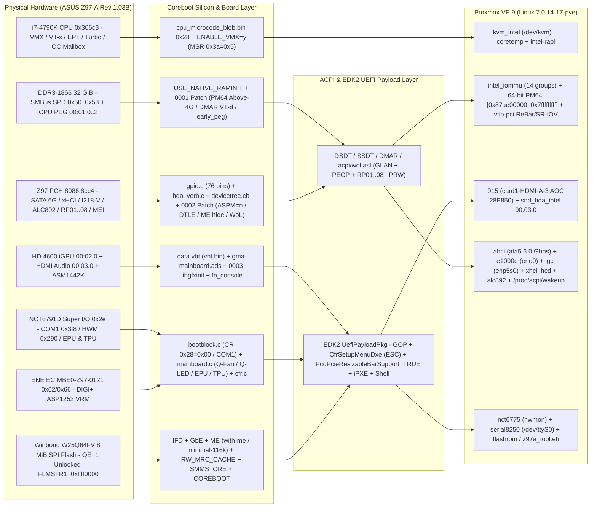
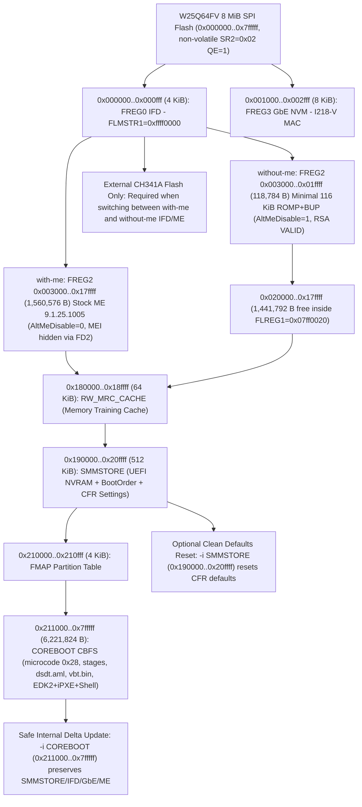
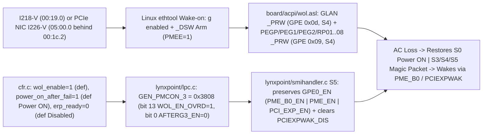
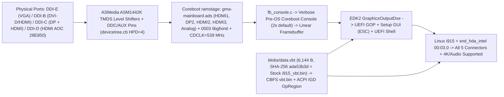
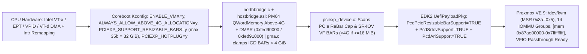

# ASUS Z97-A Hardware-to-Software Architecture & Flowchart Map

This reference documents every physical hardware subsystem on the **ASUSTeK `Z97-A` (`Rev 1.03B`)**, how Coreboot initializes and exposes it in software, where each setting is configured at build/runtime, and how Linux (`Proxmox VE 9`, kernel `7.0.14-17-pve`) binds to it.

---

## 1. End-to-End Hardware-to-Software Mapping Overview

---

## 2. SPI Flash Layout (`with-me` vs `without-me` `minimal-116k`) & Safe Flashing Map

---

## 3. Wake-on-LAN (`S3/S4/S5`) & Restore AC Power Loss (`S0`) Flow

---

## 4. Display & `i915_vbt.bin` (`blobs/data.vbt`) Pipeline

---

## 5. Virtualization, Above-4G MMIO, Resizable BAR & SR-IOV Pipeline

---

## 6. Master Hardware-to-Software Mapping Table (`Coreboot v0.17` / Release `v26.09-r3`)

| Hardware Block / Address | Software Owner (Coreboot / Patch / ASL) | Default Policy (`v26.09-r3`) | Linux Driver & Verification |
|---|---|---|---|
| **CPU `i7-4790K` (`0x306c3`)** | `cpu_microcode_blob.bin` (`0x28`), `ENABLE_VMX=y`, `mainboard.c` (`MSR 0x1ad` / `0x150`) | `VMX` ON & locked (`MSR 0x3a=0x5`); Turbo/EPU stock unless set in CFR | `kvm_intel` (`/dev/kvm`), `coretemp`, `intel-rapl` |
| **IMC + PEG (`00:00.0`, `00:01.0..2`)** | `USE_NATIVE_RAMINIT`, `0001` patch (`memory_map.c`, `early_peg.c`, `northbridge.c`), `hostbridge.asl` (`PM64`), `devicetree.cb` (`0x50..0x53`) | `ALWAYS_ALLOW_ABOVE_4G_ALLOCATION=y`, `DMAR` (`GFXVTBAR`/`VTVC0BAR`), `PAVPC=0x84100017`, `TOLUD=0x84200001` | `[mem 0x87ae00000-0x7fffffffff]`, `intel_iommu` (`14` groups) |
| **PCIe ReBar & SR-IOV Slots** | `pciexp_device.c`, `EDK2` `Makefile` (`--pcd PcdPcieResizableBarSupport=TRUE`, `PcdSrIovSupport=TRUE`, `PcdAriSupport=TRUE`) | Up to `32 GiB` (`35` bits) ReBar + `8`-bus `256 MiB` Above-4G hotplug/SR-IOV aperture | `lspci -vv` (`Resizable BAR`), `/sys/bus/pci/devices/*/sriov_totalvfs` |
| **HD 4600 (`00:02.0`) + HDMI Audio (`00:03.0`)** | `blobs/data.vbt` (`vbt.bin`), `gma-mainboard.ads`, `0001` (`gma.c`), `0003` (`libgfxinit`), `fb_console.c` | All 5 outputs enabled (`HDMI1`, `DP2`, `HDMI2`, `HDMI3`, `Analog`); `CDCLK=539 MHz`; IGD BARs clamped `<4G` | `i915` (`card1-HDMI-A-3`), `snd_hda_intel` (`00:03.0`) |
| **Z97 PCH (`00:1f.0`) + GPIOs** | `gpio.c` (`76` pins), `0002` patch (`lpc.c` Desktop CG, `smihandler.c` S5 WoL + ASM1083 guard), `devicetree.cb` | `GEN_PMCON_1=0x0210`; `GEN_PMCON_3=0x3808` (`AFTERG3_EN=0` **Power ON**, `WOL_EN_OVRD=1`) | `lpc_ich`, `setpci -s 00:1f.0 a4.w == 3808` |
| **Intel ME (`00:16.0` / `FREG2`)** | `0002` patch (`cfr.h` `me_disable=CONFIG(DISABLE_ME_PCI)`, `me.c` `FD2` hide even when `AltMeDisable=1`) | `with-me`: `9.1.25.1005` + `00:16.0` hidden; `without-me`: `116 KiB` `ROMP+BUP` + `AltMeDisable=1` + `00:16.0` hidden | `lspci -nn -s 00:16.0` returns empty |
| **PCH Flex-I/O PCIe (`00:1c.x`) & `M.2`** | `0002` patch (`lynxpoint/Kconfig` `!BOARD_ASUS_Z97_A` for `ASPM`/`CLK_PM`/`L1_SUB_STATE`, `pcie.c`), `switch-m2-ifd.py` | **All PCIe ASPM OFF**; `PCHSTRP9=0xf0544a85` (`PCIEX1_1`/`_2` active; switchable to `M.2 x2`) | `pcieport`, `igc` (`05:00.0` `2500Mb/s`), `02:00.0` (`ASM1083`) |
| **AHCI SATA (`00:1f.2`, 6 ports)** | `0002` patch (`early_pch_native.c` Gen3 `DTLE=0x02`, `sata.c` `CAP`/`0x98`/`0xa4`), `devicetree.cb` (`sata_port_map=0x3f`) | AHCI 6-port `6.0 Gbps`; `HSIO 13..14` `SATA Express` (`ata5`/`ata6`) + `HSIO 15..18` (`SATA1..4`) | `ahci` (`ata5` `CT500BX500SSD1` `6.0 Gbps`, `451 MB/s`, `0` resets) |
| **Onboard GbE (`00:19.0`) & WoL** | `blobs/gbe-z97-a.bin`, `acpi/wol.asl` (`GLAN` `0x0d`, `PEGP`/`RP01..08` `0x09`), `0002` (`lpc.c`/`smihandler.c`), `cfr.c` | `wol_enable=1` (`S3/S4/S5`), `gpe0_en_1=0x40042a46`, `MAC 9c:5c:8e:90:7e:f2` preserved in `FREG3` | `e1000e` (`eno0`), `igc` (`enp5s0`), `/proc/acpi/wakeup`, `ethtool` `Wake-on: g` |
| **Super I/O `NCT6791D` (`0x2e`)** | `bootblock.c` (`CR 0x28=0x00`), `devicetree.cb`, `mainboard.c` (Bank `0 0xae=0x03`, `4f8/4fa`, `5d/5e`, `0x66=0x11`, `0x35`, `0x39/3a`, `0x46`, PWM mode), `cfr.c`, `configs/asus-z97-a-sensors.conf` | `COM1` `0x3f8` IRQ4 (`115200 8N1`), `HWM @0x0290`, SmartFan IV Q-Fan (`29–100%`), `ErP` OFF, `Q-LEDs` ON | `nct6775` (`/etc/modules-load.d/nct6775.conf` + `/etc/sensors.d/asus-z97-a.conf`, `0` alarms), `serial8250` (`/dev/ttyS0`) |
| **`ENE EC MBE0-Z97-0121` & `ALC892`** | `mainboard.c` (`0x62`/`0x66` + `0xba 0xe3 0x03`), `hda_verb.c` (`14` verbs, `NID 0x11=0x90460130`) | EC probed + telemetry logged; DIGI+ VRM/EPU/TPU opt-in (`0`) in CFR; ALC892 full parity | `snd_hda_intel` (`00:1b.0` `1043:860b`), Coreboot `cbmem`/serial EC log |
| **UEFI Setup & Tools (`EDK2`)** | `USE_UEFI_VARIABLE_STORE=y` (`SMMSTORE`), `CfrSetupMenuDxe`, `EDK2_HAVE_EFI_SHELL=y`, `EDK2_ENABLE_IPXE=y` | Press **`ESC`** for **Coreboot Configuration** (supersedes `nvramcui`) or launch **UEFI Shell** / `iPXE` (replaces `coreinfo`) | `efibootmgr -v` (`Boot0005 proxmox`, `UEFI Shell`, `iPXE Network Boot`) |

> **Why `coreinfo` and `nvramcui` are not enabled:** Coreboot's `NVRAMCUI_SECONDARY_PAYLOAD` selects `USE_OPTION_TABLE` (legacy `cmos.layout`), which is mutually exclusive with `USE_UEFI_VARIABLE_STORE` (`SMMSTORE` + EDK2 graphical/serial `ESC -> Coreboot Configuration` CFR menu). In addition, `mrchromebox/edk2` `UefiPayloadPkg` does not chainload CBFS libpayload ELF secondary payloads (`img/coreinfo`, `img/nvramcui`); instead, EDK2 includes a full **UEFI Shell** (`Boot0003`) alongside `z97a_tool.efi` and the `ESC` CFR setup UI.
